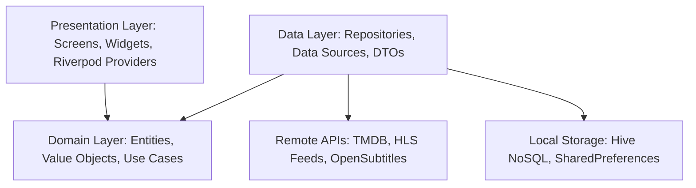

# Contributing to Cineva

Thank you for your interest in contributing to **Cineva**! We are building a modern, high-performance streaming platform, and community contributions are essential to making Cineva even better.

Please take a moment to review this document before submitting contributions.

---

## Code of Conduct

By participating in this project, you agree to abide by our [Code of Conduct](.github/CODE_OF_CONDUCT.md). Please treat all contributors, reviewers, and users with respect, kindness, and empathy.

---

## Architecture Overview

Cineva follows a **Feature-First Clean Architecture** approach to maintain a scalable, modular, and testable codebase:



Directory structure breakdown:

```text
lib/
├── core/                  # Core design tokens, global themes, HTTP clients, utility helpers
├── features/              # Feature modules
│   ├── auth/              # Optional authentication and account state
│   ├── home/              # Discovery carousel, trending shelves, genre feeds
│   ├── movie/             # Movie details, trailers, cast lists, streaming servers
│   ├── tv_series/         # TV Series details, seasons, episodes, server routing
│   ├── live_tv/           # 24/7 TV live channels catalog, HLS player, landscape drawer
│   ├── search/            # Real-time search, filters, platform catalog
│   ├── watchlist/         # User saved titles, bookmarks, continue watching
│   └── settings/          # Streaming quality, subtitle customization, legal info
└── shared/                # Common reusable widgets, player overlays, navigation shell
```

---

## Getting Started

### 1. Prerequisites

Before developing locally, ensure you have installed:
- [Flutter SDK](https://flutter.dev/docs/get-started/install) (3.12.0 or higher, stable channel)
- [Dart SDK](https://dart.dev/get-dart) (3.0.0 or higher)
- [Android Studio](https://developer.android.com/studio) or [VS Code](https://code.visualstudio.com/) with Flutter/Dart extensions
- Android SDK Platform 34+ and build-tools
- JDK 17

### 2. Fork and Clone

1. Fork the official repository to your own GitHub account:
   ```bash
   git clone https://github.com/<your-username>/Cineva.git
   cd Cineva
   ```
2. Add the upstream remote:
   ```bash
   git remote add upstream https://github.com/cineva-stream/Cineva.git
   ```

### 3. Environment Setup

Copy `.env.example` to create your local `.env`:

```bash
cp .env.example .env
```

Open `.env` in your editor and provide your TMDB credentials:
```env
TMDB_API_KEY=your_tmdb_api_key_here
TMDB_ACCESS_TOKEN=your_tmdb_read_access_token_here
OPENSUBTITLES_API_KEY=your_opensubtitles_api_key_here
```

> **Note:** Never commit your `.env` file to version control. It is ignored by `.gitignore`.

### 4. Fetch Dependencies and Run

```bash
flutter pub get
flutter run
```

---

## Development Workflow

### Branching Strategy

Always create a new branch from `upstream/main` before starting your work:

```bash
git checkout main
git pull upstream main
git checkout -b <type>/<short-descriptive-name>
```

Branch naming conventions:
- `feature/` for new capabilities (e.g., `feature/custom-audio-track-selector`)
- `fix/` for bug fixes (e.g., `fix/indosiar-hls-abr-buffering`)
- `refactor/` for code improvements without functional change (e.g., `refactor/player-controller-cleanup`)
- `docs/` for documentation updates (e.g., `docs/update-contributing-guide`)
- `perf/` for performance enhancements (e.g., `perf/image-caching-optimization`)

---

## Conventional Commits

We follow the [Conventional Commits](https://www.conventionalcommits.org/) specification to keep the Git history structured and automated changelog generation accurate.

Format:
```text
<type>(<scope>): <subject>
```

Examples:
- `feat(player): add multi-bitrate ABR HLS selection`
- `fix(live-tv): resolve audio decoder warning and stream auto-hide`
- `docs(readme): add showcase screenshots and CI status badges`
- `refactor(search): optimize query debounce and provider disposal`
- `test(watchlist): verify duplicate episode consolidation logic`

---

## Code Quality and Guidelines

Before committing, make sure your code adheres to these requirements:

1. **Format Code:**
   Ensure your code is formatted according to standard Dart conventions:
   ```bash
   dart format .
   ```

2. **Static Analysis:**
   Run static analysis and resolve any errors, warnings, or lints:
   ```bash
   flutter analyze
   ```
   PRs will not be merged if `flutter analyze` reports any issues.

3. **Automated Testing:**
   Ensure all existing and new unit/widget tests pass:
   ```bash
   flutter test
   ```
   Whenever you introduce a new feature or fix a bug, please include corresponding unit or widget tests under `test/`.

4. **Documentation Integrity:**
   Preserve existing comments and docstrings. If changing public APIs, update or add informative docstrings explaining the purpose and usage.

---

## Submitting a Pull Request

1. Push your branch to your GitHub fork:
   ```bash
   git push origin <type>/<short-descriptive-name>
   ```
2. Navigate to the [Cineva Pull Requests](https://github.com/cineva-stream/Cineva/pulls) page and click **New Pull Request**.
3. Select your fork and branch.
4. Fill in the **PR Template** thoroughly:
   - Reference related issue numbers (e.g., `Fixes #42`).
   - Describe the changes and motivation clearly.
   - Include before-and-after screenshots or screen recordings for any visual changes.
   - Confirm all items in the Quality Checklist are completed.
5. Submit the PR. Our GitHub Actions CI will automatically run tests and analysis.
6. Maintainers will review your PR, offer constructive feedback, or approve the merge.

---

## Questions and Support

If you have questions about implementation details, ideas, or architectural design:
- Open a discussion on [GitHub Discussions](https://github.com/cineva-stream/Cineva/discussions).
- Open an issue using the appropriate issue template.

