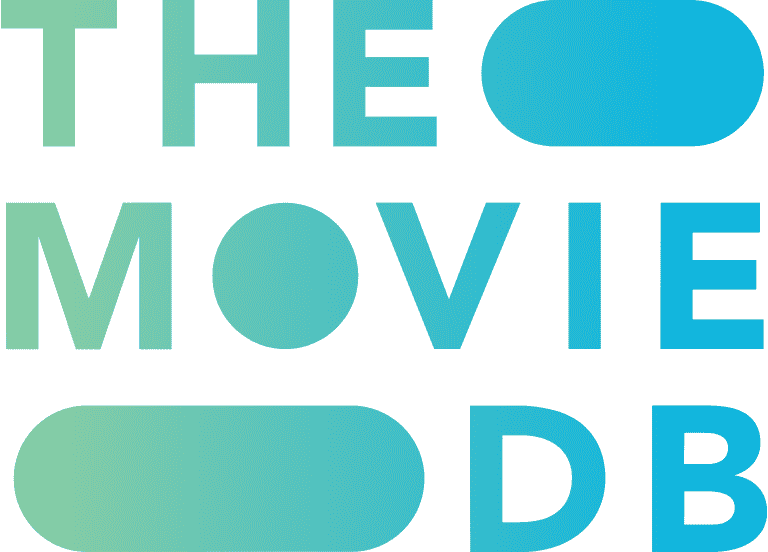

# Credits & Acknowledgments 🎬

The **Cineva** application and platform are built with the support of exceptional services, APIs, data infrastructures, and open-source projects from the global developer community. We express our sincere appreciation, respect, and gratitude to all partners and service providers below:

---

## Primary Streaming & Scraper Cluster Partner

<table>
  <tr>
    <td width="130" align="center" valign="middle">
      
    </td>
    <td>
      <h3><a href="https://github.com/flixquest/flixquest" target="_blank" rel="noopener noreferrer">FlixQuest</a></h3>
      
<strong>Scraper Infrastructure & Multi-Provider Stream Architecture</strong>

      
Powers high-speed direct HLS (<code>.m3u8</code>) stream extractions with dynamic multi-provider fallback clusters across distributed streaming sources.

      
<em>Special acknowledgment to the FlixQuest project and its maintainers for technical insights, streaming architecture, and open-source contributions.</em>

      
<strong>Repository</strong>: <a href="https://github.com/flixquest/flixquest" target="_blank" rel="noopener noreferrer">https://github.com/flixquest/flixquest</a>

    </td>
  </tr>
</table>

---

## Movie & TV Show Metadata Database

<table>
  <tr>
    <td width="130" align="center" valign="middle">
      
    </td>
    <td>
      <h3><a href="https://www.themoviedb.org" target="_blank" rel="noopener noreferrer">The Movie Database (TMDB)</a></h3>
      
<strong>Provider of Movie & TV Show Metadata, Synopsis, Cast, and Artwork</strong>

      
Delivers millions of cinematic metadata entries, high-resolution posters, backdrops, trailers, user reviews, ratings, and up-to-date airing schedules.

      
<em>Official Attribution: This product uses the TMDB API but is not endorsed or certified by TMDB.</em>

      
<strong>Website</strong>: <a href="https://www.themoviedb.org" target="_blank" rel="noopener noreferrer">https://www.themoviedb.org</a>

    </td>
  </tr>
</table>

---

## Subtitle & Multilingual Translations

<table>
  <tr>
    <td width="130" align="center" valign="middle">
      
    </td>
    <td>
      <h3><a href="https://www.opensubtitles.com" target="_blank" rel="noopener noreferrer">OpenSubtitles.com / OpenSubtitles.org</a></h3>
      
<strong>World's Largest Multilingual Subtitle Database</strong>

      
Provides millions of subtitle files for movies and TV series across English, Indonesian, and dozens of international languages with precise timing synchronization.

      
<strong>Website</strong>: <a href="https://www.opensubtitles.com" target="_blank" rel="noopener noreferrer">https://www.opensubtitles.com</a> | <a href="https://www.opensubtitles.org" target="_blank" rel="noopener noreferrer">https://www.opensubtitles.org</a>

    </td>
  </tr>
</table>

---

## Live TV Broadcasts

<table>
  <tr>
    <td width="130" align="center" valign="middle">
      
    </td>
    <td>
      <h3><a href="https://github.com/iptv-org/iptv" target="_blank" rel="noopener noreferrer">IPTV-Org Community</a></h3>
      
<strong>Curated Public & Legal Broadcast Television Channels Worldwide</strong>

      
Provides open and legally available free-to-air television playlists (M3U) curated by the global open-source community.

      
<strong>Repository</strong>: <a href="https://github.com/iptv-org/iptv" target="_blank" rel="noopener noreferrer">https://github.com/iptv-org/iptv</a>

    </td>
  </tr>
</table>

---

## Frameworks, Player Engine, & Cloud Infrastructure

<table>
  <tr>
    <td width="130" align="center" valign="middle">
      
    </td>
    <td>
      <h3><a href="https://flutter.dev" target="_blank" rel="noopener noreferrer">Flutter & Dart SDK (Google)</a></h3>
      
The modern multiplatform UI toolkit powering Cineva across Android, Android TV, and Windows Desktop with smooth 60–120 FPS native performance.

    </td>
  </tr>
  <tr>
    <td width="130" align="center" valign="middle">
      
    </td>
    <td>
      <h3><a href="https://firebase.google.com" target="_blank" rel="noopener noreferrer">Google Firebase Services</a></h3>
      
Powers Google Sign-In authentication, device analytics, and seamless real-time cloud data synchronization (Firebase Realtime Database & Firebase Analytics).

    </td>
  </tr>
  <tr>
    <td width="130" align="center" valign="middle">
      
    </td>
    <td>
      <h3><a href="https://github.com/media-kit/media-kit" target="_blank" rel="noopener noreferrer">Media-Kit Video Player Engine</a></h3>
      
High-performance video playback engine based on libmpv, supporting seamless HLS stream decoding, GPU hardware acceleration, and multi-channel audio.

    </td>
  </tr>
</table>

---

## Open Source Community Appreciation ❤️

Cineva also builds upon dozens of outstanding open-source libraries and packages across the **[pub.dev](https://pub.dev)** and **[npm](https://www.npmjs.com)** ecosystems, including:
* **Riverpod** — Reactive state management
* **Hive** — Lightweight and blazing fast local NoSQL database
* **Dio** — Powerful HTTP networking client with interceptors
* **Google Fonts & Iconsax** — Cinematic typography and modern iconography
* **Next.js & Tailwind CSS** — Foundation of the official Cineva Web showcase

---

  <em>Crafted with dedication for movie and TV series enthusiasts worldwide. Special thanks to all contributors, partners, and open-source creators! 🍿✨</em>

