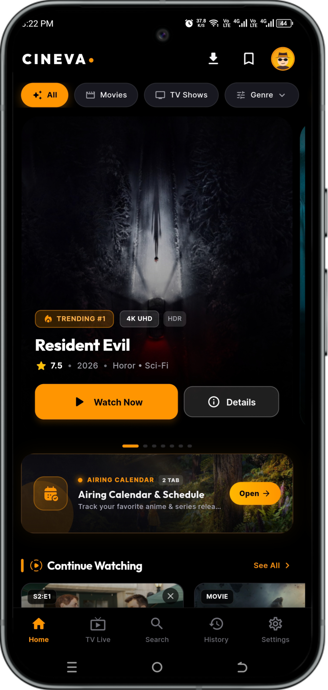
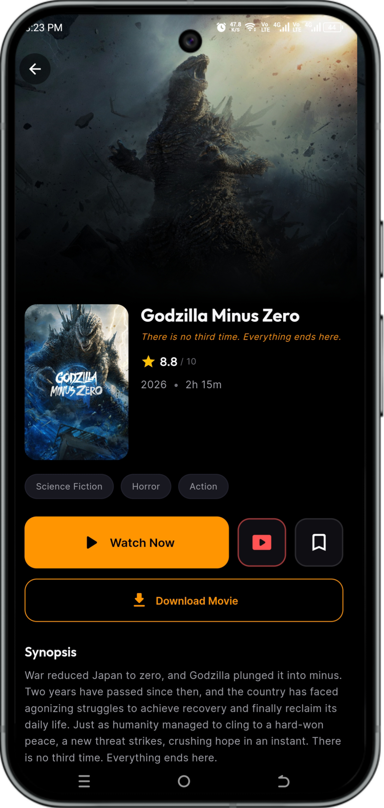
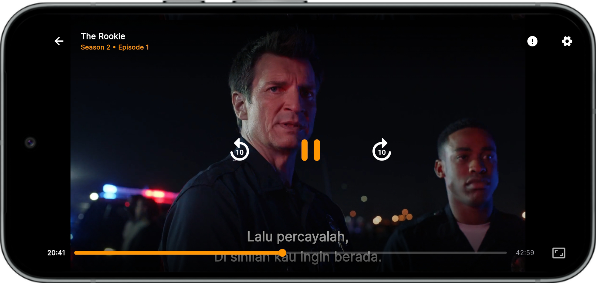
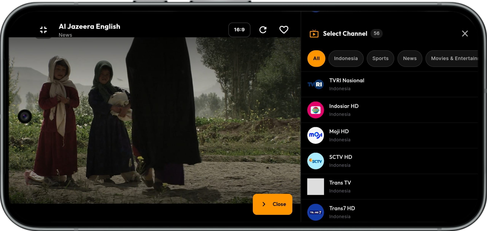

<p align="center">
  <picture>
    <source media="(prefers-color-scheme: dark)" srcset="assets/images/logo_cineva.png" />
    <source media="(prefers-color-scheme: light)" srcset="assets/images/logo_cineva_light.png" />
    
  </picture>
</p>

<p align="center">
  <strong>Modern High-Performance Movie, TV Series, and Live TV Streaming Application Built with Flutter</strong>
</p>

<p align="center">
  
  
  
  
  
  <a href="https://github.com/cineva-stream/Cineva/actions/workflows/ci.yml">
    
  </a>
</p>

---

## About Cineva

Cineva is a modern, high-performance streaming application designed to deliver a premier cinematic entertainment experience on Android devices. Crafted with a Deep Obsidian visual theme and Cinema Amber lighting accents, Cineva integrates global media metadata from The Movie Database (TMDB), a hardware-accelerated video decoding engine powered by media_kit (libmpv), comprehensive national and international Live TV channels, intelligent multi-language subtitle parsing, and an adaptive media player.

Whether exploring blockbuster movies, binge-watching serialized television programs, or streaming 24/7 live news and sports broadcasts, Cineva emphasizes fluid navigation, robust playback reliability, and user privacy through local-first data persistence.

---

## Application Previews

### Mobile Experience

<p align="center">
  
  &nbsp;&nbsp;
  
</p>

### Cinematic Playback and Live TV

<p align="center">
  
  &nbsp;&nbsp;
  
</p>

---

## Key Features

- **High-Definition Adaptive Streaming**
  Seamless multi-server streaming architecture that dynamically balances network conditions with buffering optimization, instant resolution switching, and persistent timestamp continuation.

- **Curated Live TV Catalog**
  Comprehensive live streaming suite comprising national Indonesian channels (Indosiar HD, Moji HD, SCTV HD, Trans TV, Trans7 HD, ANTV HD, Metro TV HD, Kompas TV HD, iNews HD, and others) as well as international news and documentary networks (CNN News 18, BBC News, ABC News Live, CBS News 24/7, NBC News NOW, Al Jazeera English, Bloomberg TV+, Euronews, and more).

- **YouTube-Style Landscape Channel Drawer**
  When watching Live TV in landscape fullscreen mode, tapping "Ganti Saluran" smoothly animates and resizes the video player to the left without covering the broadcast, opening an interactive channel drawer on the right with category filters, clean border styling, and channel badges.

- **Advanced Cinematic Media Player**
  Hardware-accelerated video rendering via libmpv supporting multiple aspect ratio modes (16:9, Cover, Fill), intuitive gesture controls for brightness and volume, audio track selection, variable playback speed (0.5x to 2.0x), and background audio playback.

- **Unified Custom Player Controls and Anti-Ad Touch Shield**
  Consistent Cineva cinema controls across all embedded streaming servers, augmented with a transparent touch gesture shield that captures interactions to eliminate unwanted third-party popups, redirects, and advertisement triggers.

- **Intelligent Subtitle Management**
  Automated subtitle discovery through OpenSubtitles API integration, local caching, UTF-8 BOM sanitization, and persistent user-defined styling preferences (stroke outline, vertical offset, font size, and color).

- **Personalized Content Discovery and Watchlist**
  Categorized discovery shelves, regional genre filters (Indonesian, Hollywood, Anime, Korean, Japanese, and Bollywood), real-time search with instant history suggestions, and an integrated watchlist.

- **Local Offline Persistence**
  Instant local persistence for watch progress, continue watching history, favorites, and user preferences using high-performance Hive NoSQL storage without mandatory account registration.

---

## Architecture and Technology Stack

Cineva adheres to a Feature-First Clean Architecture pattern, ensuring clear separation of concerns, high maintainability, and testability:

- **Framework**: Flutter SDK (Stable Channel)
- **Programming Language**: Dart 3
- **State Management**: Flutter Riverpod
- **Application Navigation**: GoRouter
- **Video Engine**: media_kit and media_kit_video (libmpv hardware decoding)
- **Network Client**: Dio with connection pooling, custom headers, and request interceptors
- **Local Storage**: Hive Flutter (NoSQL Key-Value Database)
- **Typography**: Google Fonts (Outfit, Inter)

---

## Getting Started

### Prerequisites

Ensure your development environment meets the following specifications:

1. Flutter SDK version 3.12.0 or higher.
2. Dart SDK version 3.0.0 or higher.
3. Android SDK targeting API level 34 or higher.
4. Java Development Kit (JDK) 17.
5. Android Studio or Visual Studio Code with Flutter extensions installed.

### Installation

1. **Clone the repository:**
   ```bash
   git clone https://github.com/cineva-stream/Cineva.git
   cd Cineva
   ```

2. **Configure environment variables:**
   Copy the example environment file:
   ```bash
   cp .env.example .env
   ```
   Open `.env` and supply your TMDB API credentials and optional OpenSubtitles API key:
   ```env
   TMDB_API_KEY=your_tmdb_api_key_here
   TMDB_ACCESS_TOKEN=your_tmdb_read_access_token_here
   OPENSUBTITLES_API_KEY=your_opensubtitles_api_key_here
   ```

3. **Install project dependencies:**
   ```bash
   flutter pub get
   ```

4. **Launch the application:**
   ```bash
   flutter run
   ```

---

## Building Release APK

To compile an optimized release APK with code obfuscation and debug symbol splitting:

```bash
flutter build apk --release --obfuscate --split-debug-info=./debug-info
```

The resulting APK will be generated at:
```
build/app/outputs/flutter-apk/app-release.apk
```

---

## Running Automated Tests

To run the complete suite of unit, widget, and integration tests:

```bash
flutter test
```

To run static analysis:

```bash
flutter analyze
```

---

## Contributing

Contributions to Cineva are warmly welcomed and strongly encouraged.

Whether you want to fix reported bugs, improve streaming reliability, optimize memory consumption, implement new player capabilities, refine user interface animations, add localization strings, or enhance documentation, your involvement is highly valued.

Please read our [Contributing Guidelines](CONTRIBUTING.md) to learn how to set up your local development environment, run test suites, adhere to coding style conventions, and submit Pull Requests.

All participants are expected to follow our [Code of Conduct](.github/CODE_OF_CONDUCT.md).

For vulnerability disclosure and security advisories, please review our [Security Policy](SECURITY.md).

---

## License

This project is open-source software licensed under the **GNU General Public License v3.0 (GPL-3.0)**.

Please read the [LICENSE](LICENSE) file located in the root directory of this repository for the full terms and conditions regarding copying, distribution, and modification.

---

## Maintainers

Developed and maintained by the **Cineva Group**.
